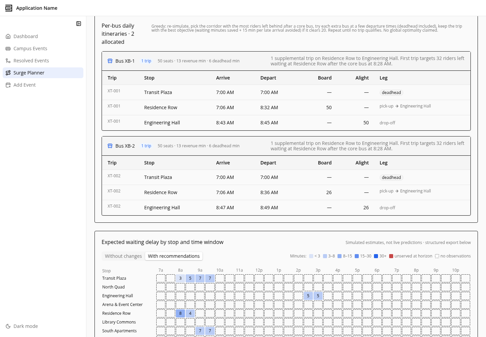
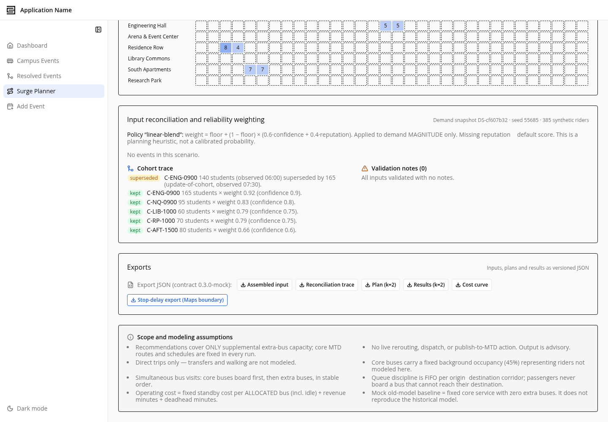
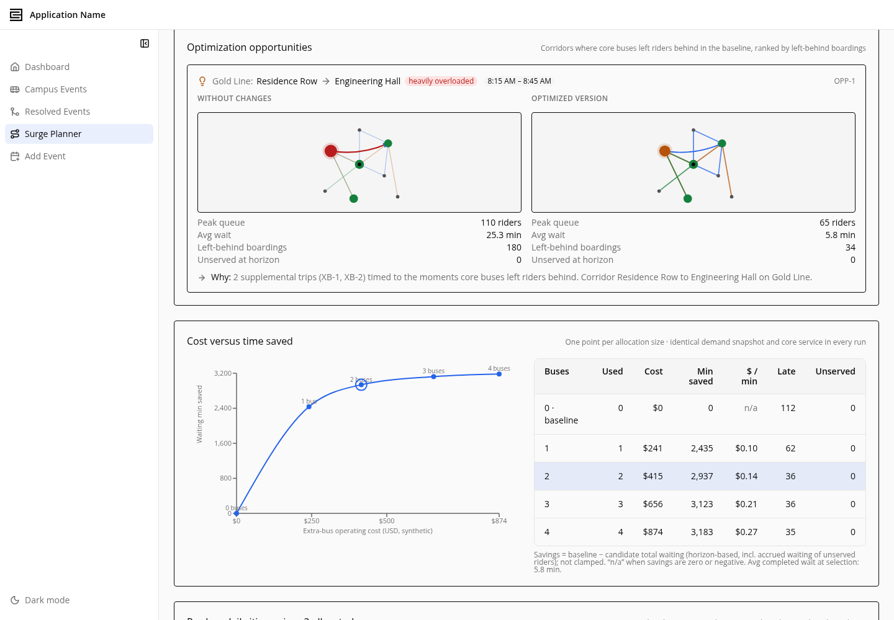

# C3 Bus Route Optimization — Proof of Concept

A proof-of-concept C3 AI application for **planning supplemental bus service around campus
events**. Large events at the University of Illinois (games, concerts, conferences) create short,
sharp demand spikes that scheduled MTD service doesn't fully cover. This app ingests the campus
event calendar, estimates event-driven transit demand, and **optimizes a set of additional buses
and supplemental routes** to serve that demand — then visualizes the proposed network on a live map
and quantifies the improvement.

## What it does

1. **Collect** — scrapes the UIUC campus event calendar into `CampusEvent` records (venue, time,
   expected attendance).
2. **Resolve & estimate** — deduplicates/merges event observations and estimates per-event transit
   demand (`attendance × transit share`), attributing it to candidate pickup stops.
3. **Optimize supplemental routes** — `RoutePlanner.generateNetwork` groups event-driven demand into
   demand corridors, assigns a fleet of additional buses to them, and schedules back-to-back runs,
   reporting riders served vs. unserved and location coverage.
4. **Visualize** — an animated Leaflet/OpenStreetMap map draws each proposed route through its real
   stop coordinates with buses moving along it, color-coded, with optimization metrics.
5. **Simulate (SurgePlanner bridge)** — maps the plan into a scenario-scoped simulator
   (`SimRunner`) to sweep how many extra buses to add and compare the resulting cost/wait curve.

## Screenshots

### Campus event collection & route planning

### Supplemental route optimization — SurgePlanner

### Route map (planning view)

## Key components

| Area | Type / file |
| --- | --- |
| Campus events | `pkg613654a2/src/CampusEvent.c3typ`, `CampusVenue.c3typ`, `UiucEventScraper.*` |
| Event resolution | `pkg613654a2/src/EventResolver.*`, `MergedEvent.c3typ` |
| Route optimizer | `pkg613654a2/src/RoutePlanner.*`, `TransitPlanner.*`, `PlannerConfig.c3typ` |
| Simulator bridge | `pkg613654a2/src/RouteNetworkSimBridge.*` + `src/simulator/` |
| Transit data clients | `pkg613654a2/src/MtdRoutesClient.*` (CUMTD realtime), `GtfsClient.*` (static GTFS), `OsrmClient.*` (street snapping), `GoogleDirectionsClient.c3typ` |
| Animated map | `pkg613654a2/ui/react/src/pages/Busplanning/TransitRouteMap.tsx` |
| Frontend pages | `pkg613654a2/ui/react/src/pages/Busplanning/`, `pages/SurgePlanner/`, `pages/SurgePlanning/` |

## The map & its metrics

The route map (Campus Events → **Transit routes** tab) renders proposed routes as green,
grid-aligned (Manhattan) polylines through real stop coordinates on an OpenStreetMap basemap, with
one animated bus per assigned vehicle. The metrics row demonstrates the optimization:

- **Mean time to service — old vs. new** (expected wait + ride, before vs. after supplemental buses)
- **Riders served / demand** and **service coverage %**
- Routes, buses, stops, and total route length

## Live CUMTD data (optional)

The app runs end-to-end on real event data and real stop coordinates out of the box. To additionally
overlay the full existing MTD system (gray routes) and snap routes to street centerlines, provide a
CUMTD developer key in **`MtdApiConfig.apiKey`** (Configure → Data Fusion). The GTFS and
street-snapping clients (`GtfsClient`, `OsrmClient`) consume that key to pull on-street geometry from
the CUMTD realtime API and the static GTFS `shapes.txt` feed.

## Tech

C3 AI Platform (entity types + JS/`js-server` methods), React + TypeScript frontend
(Vite, Tailwind, shadcn-style components), Leaflet + react-leaflet over OpenStreetMap tiles.

