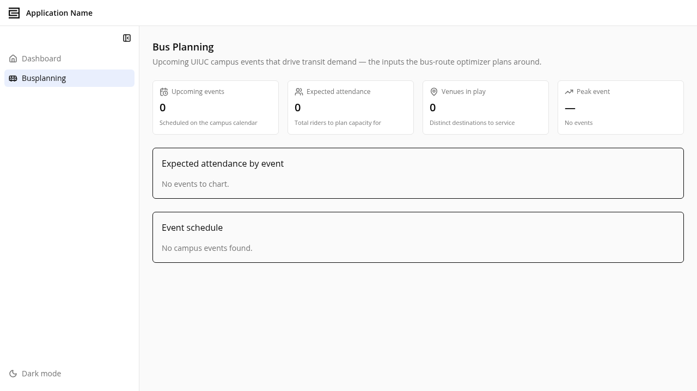
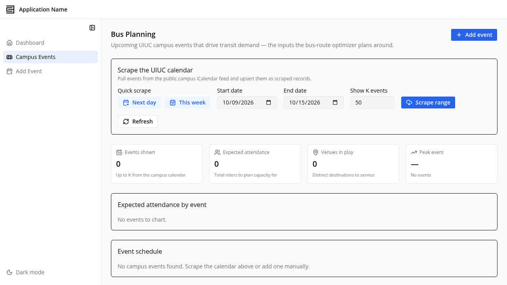
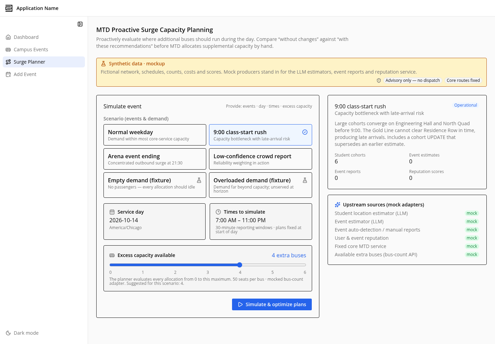
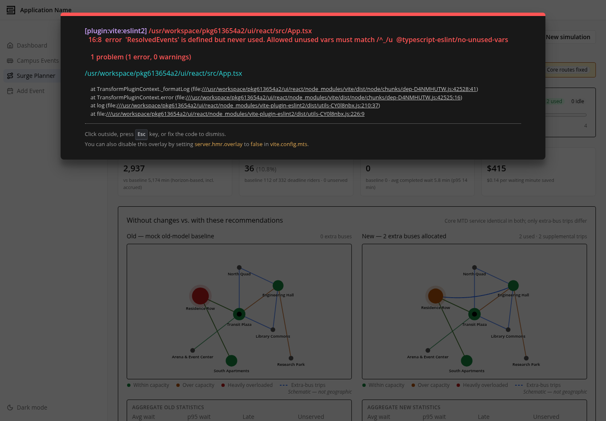
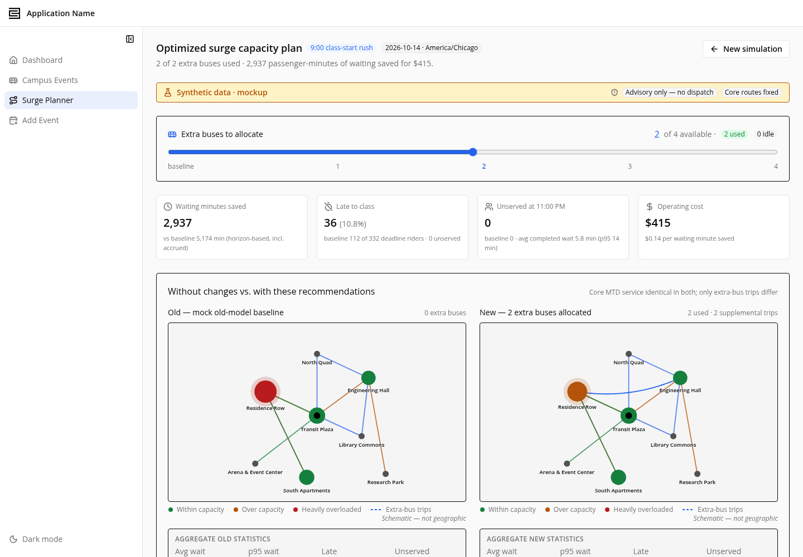
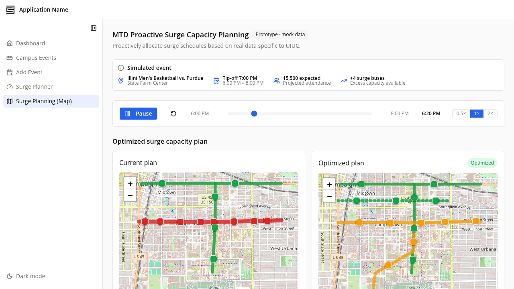
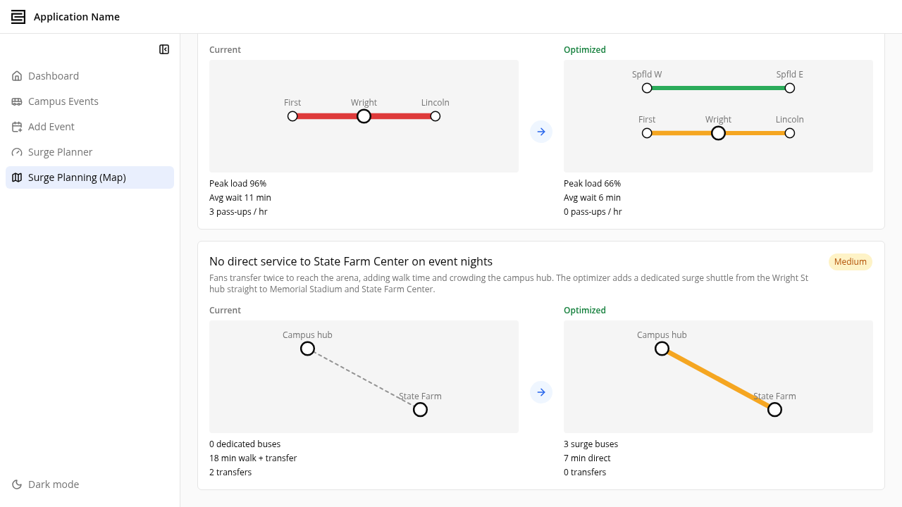
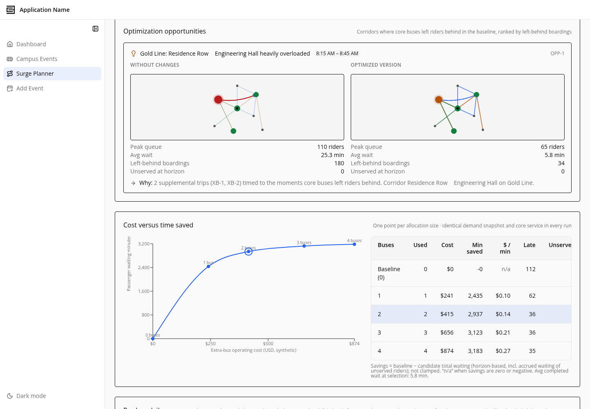

# C3 Bus Route Optimization — Proof of Concept

A proof-of-concept C3 AI application for **planning supplemental bus service around campus
events**. Large events at the University of Illinois (games, concerts, conferences) create short,
sharp demand spikes that scheduled MTD service doesn't fully cover. This app ingests the campus
event calendar, estimates event-driven transit demand, and **optimizes a set of additional buses
and supplemental routes** to serve that demand — then visualizes the proposed network on a live map
and quantifies the improvement.

## 1. Campus events

The **Campus Events** page collects upcoming UIUC campus events — the demand inputs the route
optimizer plans around. Events are pulled from the public campus iCalendar feed (or added manually)
and stored as `CampusEvent` records with venue, time, and expected attendance, summarized by total
riders, venues in play, and the peak event.

## 2. Resolve & plan transit routes

Collected events are de-duplicated and merged into canonical demand, then `RoutePlanner` groups that
demand into corridors, assigns a fleet of additional buses, and schedules back-to-back runs —
reporting riders served vs. unserved and location coverage.

## 3. Surge Planner simulation

The **Surge Planner** runs the plan through a scenario-scoped simulator (`SimRunner`) to sweep how
many extra buses to add and compare the resulting cost/wait curve. It is seeded with **1 real
scenario plus 5 simulated scenarios for testing**, so you can set up a run, simulate it, and read
the before/after results side by side.

## 4. Route map & optimization opportunities

An animated Leaflet/OpenStreetMap map draws each proposed route through its real stop coordinates
with buses moving along it, color-coded, alongside the optimization metrics — mean time to service
(old vs. new), riders served / demand, service coverage %, and route length. The optimization
opportunities panel highlights the corridors and time windows where extra buses recover the most
rider waiting time.

## Key components

| Area | Type / file |
| --- | --- |
| Campus events | `pkg613654a2/src/CampusEvent.c3typ`, `CampusVenue.c3typ`, `UiucEventScraper.*` |
| Event resolution | `pkg613654a2/src/EventResolver.*`, `MergedEvent.c3typ` |
| Route optimizer | `pkg613654a2/src/RoutePlanner.*`, `TransitPlanner.*`, `PlannerConfig.c3typ` |
| Simulator | `pkg613654a2/src/RouteNetworkSimBridge.*` + `src/simulator/` (`SimRunner`, `SimScenario`) |
| Transit data clients | `pkg613654a2/src/MtdRoutesClient.*` (CUMTD realtime), `GtfsClient.*` (static GTFS), `OsrmClient.*` (street snapping) |
| Animated map | `pkg613654a2/ui/react/src/pages/Busplanning/TransitRouteMap.tsx` |
| Frontend pages | `pkg613654a2/ui/react/src/pages/Busplanning/`, `pages/SurgePlanner/`, `pages/SurgePlanning/` |

## Live CUMTD data (optional)

The app runs end-to-end on real event data and real stop coordinates out of the box. To additionally
overlay the full existing MTD system (gray routes) and snap routes to street centerlines, provide a
CUMTD developer key in **`MtdApiConfig.apiKey`** (Configure → Data Fusion). The GTFS and
street-snapping clients (`GtfsClient`, `OsrmClient`) consume that key to pull on-street geometry from
the CUMTD realtime API and the static GTFS `shapes.txt` feed.

## Tech

C3 AI Platform (entity types + JS/`js-server` methods), React + TypeScript frontend
(Vite, Tailwind, shadcn-style components), Leaflet + react-leaflet over OpenStreetMap tiles.
