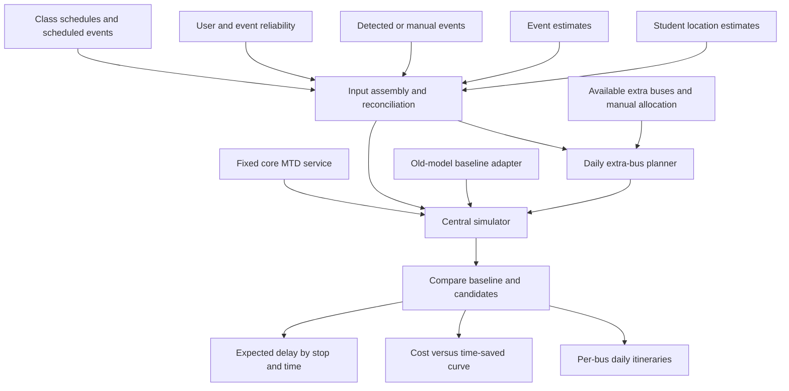

# Bus planning simulator — agent context and implementation brief

## Your assignment

Implement a working simulator for planning additional bus capacity using mock data. Other agents are building the real data sources. Define clear contracts and separate source adapters from the simulation engine so their real outputs can be connected later.

Inspect the target project before making changes. Follow its existing architecture, libraries, coding conventions, and local agent instructions. Implement the system, validate it, and document how to run it. Make routine implementation decisions autonomously; record assumptions and flag decisions that materially change the agreed scope.

This file is a standalone handoff derived from a photographed whiteboard and subsequent meeting notes. The clarified meeting notes take precedence over ambiguous whiteboard labels. No real data, existing old-model implementation, API schema, or target-project structure has been supplied.

## Product purpose

Provide proactive recommendations showing what happens without changes versus with additional bus capacity. The system supplements MTD’s existing routes through the program referred to in the meeting as Transport X / Illini-X. Treat those as provisional program labels, not verified external API names.

The operational decision is how many extra buses MTD should allocate and where those buses should run during the day. MTD allocates buses manually. The simulator evaluates alternatives and produces advisory plans; it does not dispatch buses.

## Agreed architecture

Four parallel components feed a central simulator:

1. LLM-based student location estimator.
2. LLM-based event estimator.
3. Event auto-detection or manual user input.
4. User/event reputation scoring, providing reliability per user and event.

The simulator also consumes scheduled events, student class schedules, fixed core-route schedules, and available bus counts. It compares candidate recommendations with an old-model baseline.

The LLM components and reputation producers are being developed elsewhere. This implementation consumes their structured outputs through mock adapters. Do not build live LLM calls or require external credentials to run the simulator.

Input assembly is a proposed implementation boundary for validating and reconciling the four sources. It must preserve source provenance rather than hide disagreements between sources.

## Planning boundaries

- Plan routes at the start of the day using scheduled events, estimated student locations, and class schedules.
- Keep core MTD routes and schedules fixed across all simulations.
- Plan only supplemental service supplied by extra buses.
- Treat extra-bus count as a variable controlled by MTD.
- Do not implement live rerouting. The meeting rejected it because a poor mid-day routing decision is difficult to recover from.
- Do not compete with or override MTD’s predetermined routing algorithm.
- Do not track automatic route changes at end stops. This was explicitly considered and excluded.
- Do not dispatch buses, mutate external schedules, or make external operational changes.

The team still needs to formally confirm that recommendations cover only additional capacity allocation. Proceed using that narrow interpretation; document it as a scope assumption.

## Required outputs

### Daily extra-bus plans

Produce a complete itinerary for each assigned extra bus: for example, Bus A visits Stop X, then Stop Y. Include ordered stops, arrival/departure times, trip boundaries, capacity, and a brief explanation of the demand served.

### Cost versus time saved

Evaluate zero through a configurable maximum number of extra buses. Show the operating cost and service improvement for each allocation. Surface diminishing returns and let MTD choose the allocation; avoid presenting one unexplained score as the decision.

### Proactive comparison

Show baseline outcomes and recommended-plan outcomes together, including expected delays, unmet demand, and late arrivals. Frame the output as “without changes” versus “with these recommendations.”

### Student-facing delay estimates

Produce expected waiting delay at each stop over time. Expose a structured export suitable for a future Google Maps integration. Implement only the export boundary now, not a Maps integration. Label estimates as simulated rather than live.

## Data contracts

Use the target project’s language and validation patterns. The following are semantic requirements, not a prescribed external API schema. Define versioned contracts, stable identifiers, documented units, and explicit timestamp/timezone handling. Avoid dependencies on a producer’s internal implementation.

### Common conventions

- Stable IDs for stops, routes, buses, trips, events, users, and demand cohorts.
- Absolute timestamps with offsets or UTC values, plus an explicit service timezone and service date.
- Travel, dwell, wait, and lateness values in documented units; use minutes in user-facing metrics.
- Currency and cost units explicitly specified.
- Confidence/reliability on a documented scale, proposed as 0–1 for mock data.
- Source provenance and observation/forecast timestamps.
- Input validation for invalid references, time ordering, capacities, and score ranges.
- Separate confidence from the magnitude of estimated demand.
- No personally identifying student records are necessary for the mock scenarios; use synthetic cohorts.

### Student location estimates

Include cohort ID, predicted student count, origin stop/location, destination stop/location, arrival-at-stop time or arrival time window, class start time where relevant, and confidence. Specify whether counts represent distinct cohorts or updates to the same cohort.

### Event estimates

Include stable event ID, location/stop references, start/end timestamps, estimated attendance, expected transport-demand timing, destination distribution if available, confidence, and source provenance. Attendance is not automatically equal to bus ridership.

### Detected/manual event reports

Include report ID, canonical event ID if known, detected/manual source, submitting user ID where applicable, reported location, times, attendance/details where provided, and report timestamp. Keep raw reports distinguishable from reconciled events.

### Reputation input

Include reliability scores keyed by user ID and event ID, the score scale, and timestamps where available. Document defaults for missing scores. This simulator consumes scores; calculating reputation from real-world behavior is outside its scope.

### Core-service input

Include stops, route stop sequences, fixed scheduled trips, arrival/departure times, bus capacities, and travel-time data. Core service must remain identical in baseline and candidate scenarios.

### Extra-bus availability

Include available bus IDs/count, capacities, availability windows, starting locations, and operating-cost assumptions. Mock the bus-count API behind an adapter. Do not invent or bind to a real API endpoint.

### Assembled simulation input

Define a single validated input object containing contract version, scenario ID, service date/timezone, simulation horizon, all source inputs or reconciled outputs with provenance, fixed service, extra-bus availability, cost configuration, simulation assumptions, and random seed.

### Plan and results

Define separate plan and results contracts. A plan identifies core service and extra-bus itineraries. Results identify the input snapshot, seed, plan, metrics, stop/time-window delays, and accounting totals. Include contract version and units in exports.

## Reconciliation and reliability

Prevent double-counting when estimated events and detected/manual reports describe the same event. Prefer canonical event IDs. If mock data demonstrates fallback matching, make its location/time rules explicit and test them.

Also define how class-related demand and event-related demand overlap. A single student cohort must not appear twice merely because two producers refer to it. If real-source identity is unresolved, document the integration requirement and keep mock cohorts explicitly distinct or linked.

Use a simple, configurable reliability-weighting policy for mock data. Explain how confidence and reputation affect expected demand, including defaults and missing scores. Do not imply that a weighted score is a calibrated probability. Avoid silently multiplying overlapping confidence measures without explaining the assumption.

Preserve a reconciliation trace: which reports contributed to an event, which estimates were superseded, and which policy produced the final demand. Retain low-confidence events so their effect can be inspected.

## Mock scenarios

Create a small fictional network that runs without external services. Include several stops, fixed routes, classes, scheduled events, and extra buses. Label all locations, schedules, counts, costs, and scores as synthetic.

Provide at least these scenarios:

1. Normal demand within most core-service capacity.
2. A class-start rush with a capacity bottleneck and late-arrival risk.
3. An event-ending surge with concentrated outbound demand.
4. A low-confidence event report demonstrating reliability weighting.
5. Empty demand and overloaded demand as test fixtures.

Include duplicate reports for one event and an explicit overlap example for reconciliation tests. Choose mock assumptions that illustrate tradeoffs without making every additional bus appear beneficial by construction.

## Simulation engine

Keep the engine independent of the UI and source adapters. Use a deterministic, seeded simulation, preferably an event-driven approach unless the project already has a suitable simulation convention.

Model:

- Passenger/cohort arrivals at origin stops.
- Destination-aware queues.
- Scheduled core-bus visits and travel times.
- Boarding and alighting with capacity constraints.
- Passengers left waiting when a bus is full or cannot serve their destination.
- Extra-bus departures, ordered stops, and repeat trips when feasible.
- Configurable dwell times and travel times.
- Passenger waiting time, in-vehicle time, total trip time, and class-arrival lateness.
- Passengers still waiting or onboard at the simulation horizon.

For the initial implementation, direct trips without transfers are acceptable if explicitly documented. Never board passengers on a trip that cannot reach their destination. Document queue discipline, handling of simultaneous events, and how arrival windows become passenger demand.

Represent generated demand as an immutable snapshot. Reuse the same snapshot across all allocation sizes and baseline runs, not merely the same seed: different event consumption orders must not change demand between plans.

Maintain accounting invariants: generated passengers equal completed passengers plus waiting, onboard, and any explicitly modeled other states. Never drop passengers silently, exceed bus capacity, move a bus instantaneously, or schedule overlapping trips for a bus.

## Baseline / old model

Search the target project for an existing old-model implementation. If found, integrate it through a clear adapter and document what it supplies.

If none exists, implement a mock baseline using fixed core service and zero extra buses. Label it “mock old-model baseline” everywhere relevant. Do not claim it reproduces the historical model.

With that mock baseline, the zero-extra-bus candidate must match baseline results. If integrating a real old model later, document any different assumptions before comparing it with new candidates.

## Extra-bus planning heuristic

Implement a practical, explainable heuristic without requiring an external optimization service.

Suggested approach:

1. Run the baseline to identify stop/destination/time-window bottlenecks.
2. Generate candidate supplemental trips that serve those bottlenecks.
3. Check bus availability, starting location, deadhead travel, dwell time, capacity, and return/repositioning feasibility.
4. Select and schedule trips using a documented benefit/cost or waiting-time reduction criterion.
5. Re-simulate the resulting plan and report measured outcomes.

For each allocation from zero to the configured available maximum, produce a feasible daily plan and evaluate it with identical demand and core service. Do not require every available bus to run when there is no useful demand; distinguish allocated, used, and idle capacity.

Describe the heuristic and limitations. Do not claim global optimality or guaranteed monotonic improvement. If a candidate performs worse than baseline, display that result accurately rather than hiding or clamping it.

## Metrics and units

Report at least:

- Average and p95 passenger waiting time in minutes.
- Total passenger waiting minutes saved versus baseline.
- Average trip time, if useful for the chosen model.
- Number and percentage of students arriving late to class.
- Passengers unserved at the end of the horizon.
- Extra-bus operating cost and currency.
- Cost per passenger waiting minute saved.

Define metric denominators. For lateness, use only passengers with a class deadline; report completed late arrivals separately from deadline-bearing passengers who remain unserved. Do not count an unserved passenger as on time.

Avoid survivor bias in waiting-time comparisons. Include accrued waiting for passengers still waiting at the horizon in a clearly labeled horizon-based total; show completed-passenger averages/percentiles alongside unserved counts and document censoring. Do not describe accrued waiting as a final eventual wait.

Calculate savings as baseline minus candidate using comparable definitions. Do not clamp negative savings. Return a meaningful unavailable value for cost per minute saved when savings are zero or negative, with an explanation in the interface. Document whether operating cost includes allocated idle buses, driving time, deadhead time, dwell time, and fixed costs.

## Review interface

Build a simple interface using existing project components and conventions. Include:

- Scenario selection.
- Extra-bus allocation control within the available range.
- Baseline-versus-candidate metrics.
- Per-bus daily itinerary table.
- Cost-versus-time-saved chart across allocations.
- Expected delay by stop and time window.
- Brief explanations of why trips were recommended.
- Visible synthetic-data, scope, and assumption labels.
- JSON export of inputs, plans, and results.

For stop-delay exports, include stop ID, time-window boundaries, estimated wait, supporting passenger count, and whether data is absent. Do not encode no observations as zero wait.

Keep the interface advisory. It must not contain a functional dispatch or publish-to-MTD action. Handle validation errors and empty results clearly using the project’s normal patterns.

## Implementation organization

Adapt these responsibilities to the existing project rather than imposing a new framework:

- Contracts and input validation.
- Independent mock source adapters.
- Input assembly/reconciliation.
- Demand generation.
- Simulation engine.
- Old-model adapter.
- Extra-bus planner.
- Metrics and scenario comparison.
- Interface and exports.
- Focused tests and run/integration documentation.

Make adapters replaceable through explicit interfaces or dependency injection. Do not scatter mock values inside engine or UI code. Avoid speculative external connectors, credentials, infrastructure, and persistent storage unless needed by the existing project.

## Validation

Add meaningful tests for:

- Deterministic results for an identical immutable demand snapshot and seed.
- Passenger accounting, capacity limits, and destination eligibility.
- Feasible travel times and nonoverlapping bus itineraries.
- Zero extra buses matching the mock baseline.
- Duplicate event reconciliation and cohort overlap handling.
- Reliability weighting and missing-score defaults.
- Empty demand, overload, and event-ending surge.
- Lateness denominators and unserved passengers.
- Metric units, negative/zero savings, and cost calculations.
- Stop windows with no observations.

Run appropriate project tests, typechecking, linting, and formatting. Verify the interface in a browser if the project supports it. Do not rely on screenshot appearance to validate simulation correctness.

## Handoff documentation

Provide exact integration points for the other agents:

- Contract names/files and versions.
- Required and optional fields, units, timestamps, and identifiers.
- Example mock payloads for each source.
- How to replace each mock adapter.
- Reconciliation ownership and expectations for shared event/cohort IDs.
- Missing-data and reliability defaults.
- Baseline adapter behavior.
- JSON result/export shapes.

Include commands to run the demo and tests, scenario descriptions, modeling assumptions, heuristic limitations, and remaining decisions.

## Open decisions

Proceed with documented mock defaults while keeping these configurable:

- Formal team confirmation that only supplemental capacity is in scope.
- Real old-model behavior and comparison contract.
- Real bus-count API and availability semantics.
- Producer payload schemas and shared identifiers.
- Calibration of confidence/reputation weighting.
- Actual travel times, capacities, costs, and demand distributions.
- Whether transfers or more detailed pedestrian travel are needed later.
- Exact future Google Maps integration contract.

These gaps do not block a self-contained mock implementation. Do not present defaults as agreed operational facts.

## Acceptance criteria

The implementation is complete when:

1. It runs locally with synthetic data and no external credentials.
2. All four source contracts feed the assembled simulator input through independent adapters.
3. Fixed core service remains unchanged in every candidate.
4. Baseline and candidates use the same generated demand.
5. Allocation sizes produce feasible daily extra-bus itineraries and comparable metrics.
6. The interface presents itineraries, baseline comparisons, cost/time tradeoffs, and stop-delay estimates.
7. Inputs, plans, and results can be exported as structured JSON.
8. Meaningful validation passes, or concrete environment blockers are clearly reported.
9. Documentation lets other agents replace mock sources without rewriting the engine.

Finish with a concise implementation summary, run instructions, validation results, and unresolved decisions. Do not stop at a design proposal: implement the working mock system.
